<h1 align="center">
  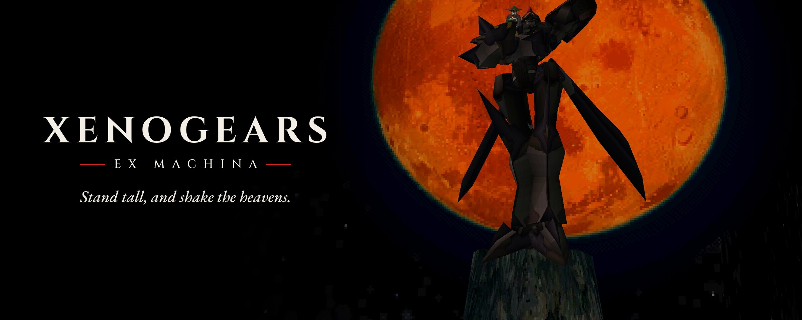
</h1>

  <a href="https://github.com/brianblakely/xenogears-ex-machina/releases/latest"><b>Download</b></a>
  &nbsp;·&nbsp;
  <a href="https://brianblakely.github.io/xenogears-ex-machina/"><b>Play in your browser</b></a>
  &nbsp;·&nbsp;
  <a href="MANUAL.md"><b>Player's manual</b></a>
   
  Windows · macOS · Linux · Android · Meta Horizon OS · Web browsers · Bring your own discs

Xenogears: Ex Machina (XEM) is an independent, open-source project to preserve the
PlayStation role-playing game Xenogears and bring it to modern computers, mobile
devices and VR headsets.
It keeps the game's identity — its world, artwork and gameplay — while opening
the door to modern presentation, more ways to play, and tools for creating new
adventures.

## Project status

| Milestone | Status | Scope |
| --- | --- | --- |
| Original-game decompilation | **Complete** | Both [supported North American discs](docs/runtime.md#discs); all 26 program components rebuild byte for byte. |
| Modern platform foundation | **Complete** | One runtime for the Linux desktop, web browsers, Android and VR headsets (Android and VR verified on emulators). |
| First playable section | **Complete** | An early stretch of the game, with exploration, dialogue, a battle and its rewards, menus, saving and a movie, plays end to end with identical results on every platform. |
| Modern visuals | **Complete** | Modern, HD-2D-inspired and PS1 looks, true widescreen, high resolution and a VR virtual screen. |
| Controls for every device | **Complete** | Keyboard, mouse, gamepad, touch, VR controllers and hand tracking. |
| Conveniences, VR views and headphone audio | **Complete** | Save states, rewind, fast-forward, memory card import, gameplay options, the VR diorama, first-person view, clearer movies and Binaural sound. |
| Complete game | **Complete** | Both-disc story, optional content and minigames. |
| Playable release | **Complete** | [v1.0](https://github.com/brianblakely/xenogears-ex-machina/releases/tag/v1.0): portable native downloads and browser play; [supported platforms and setup](docs/releases.md). |
| Mods and creation tools | Planned | Mod management, gameplay extensions, desktop editors and AI-assisted authoring. |

[Player's manual](MANUAL.md) · [Full roadmap](plan.md) · [Runtime and feature guide](docs/runtime.md)
· [Build and verification guide](docs/matching.md)

## Why recover the original code?

Decompilation means working backward from the game on disc to reconstruct source
code that developers can read, study and change. It produces reconstructed source,
not the studio's original development files. A byte-for-byte match provides a
precise reference for preserving the original game while adapting it to new
hardware.

XEM runs that recovered logic directly on modern hardware; it does not wrap a
PlayStation emulator in a new interface. The browser version runs the same game
logic.

## Player experience

### Play across more devices

XEM runs natively on Linux, where development is led on Arch Linux, and in web
browsers, which run the same compiled game code on WebGPU or WebGL2 (tested in
Chromium). An Android app, VR through OpenXR and browser-based VR through WebXR
run the same game too, verified on the Android emulator and simulated headsets.
Phones and tablets get touch controls made for them. Downloads include Windows,
macOS, Linux and a shared Android/Meta Horizon OS APK. Full editing tools will be
desktop-focused; mobile, headset and browser versions are intended for playing
the game and compatible prebuilt mods.

  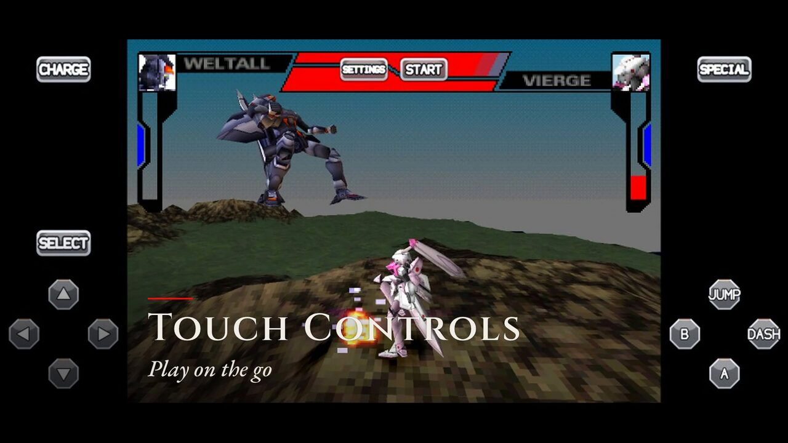
  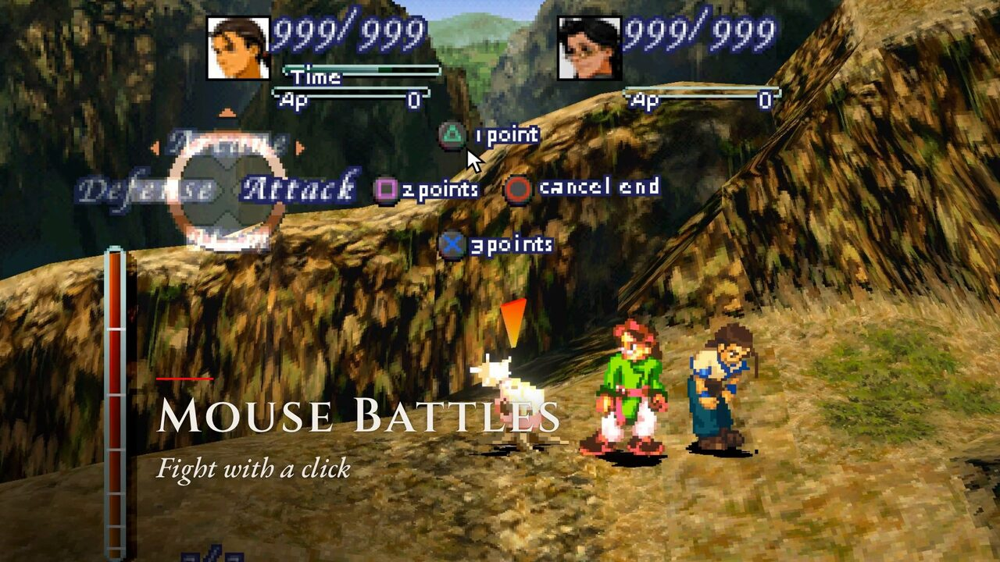

### Keep the original art. Choose a new look.

XEM's renderer redraws the game's own 3D scenes at up to eight times the
original resolution, at any window size and aspect ratio. True widescreen fills
the sides with the game's own scenery, the field camera can pull back for a
wider view, and optional motion interpolation smooths motion on high-refresh
displays, all while the original gameplay timing stays intact. Choose a modern
look, an HD-2D-inspired look, or a PS1 look whose original quirks (warping
textures, vertex snapping, dithering, 15-bit colour) switch on and off one by
one. The console's own picture is always one setting away.

  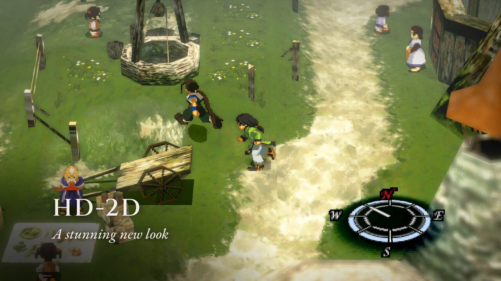
  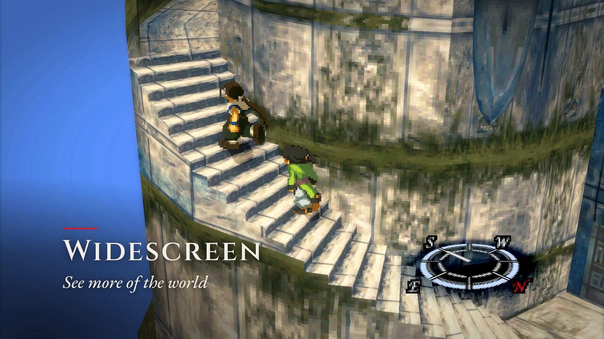
  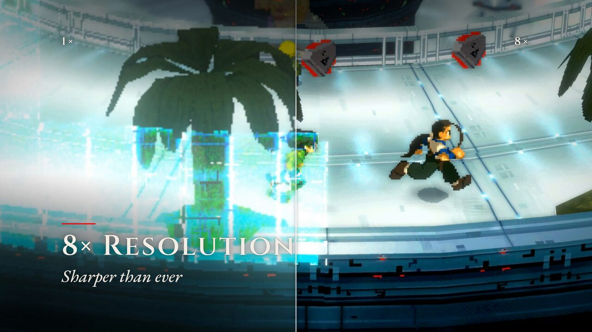
  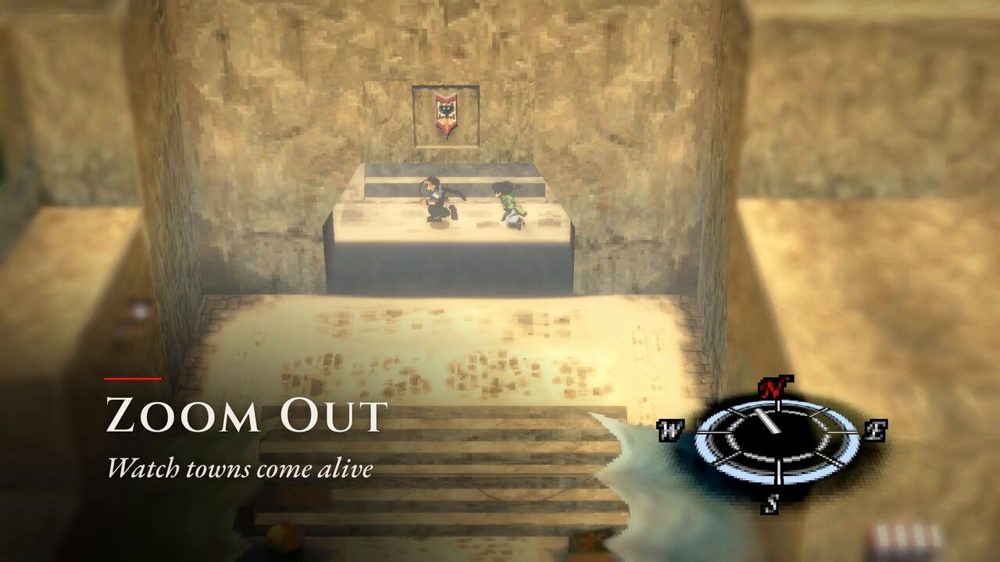

The HD-2D-inspired look brings scene lighting, shadows, atmosphere and
adjustable depth of field to the existing game art. It is an effects treatment,
not an art remake: the original sprites, textures, models and animations remain,
with no replacement art pack required. Graphics style and flat-screen or VR
viewing are separate choices.

Full-motion video plays cleaner too. XEM rebuilds each movie frame from the
game's decoded video, smooths the block seams, then enlarges and sharpens the
picture, with the original video one setting away.

  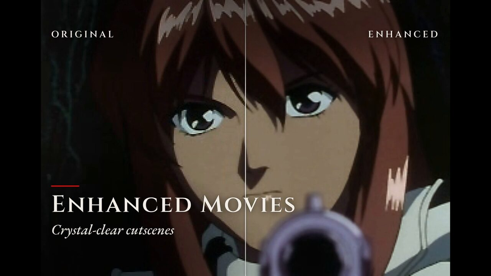
  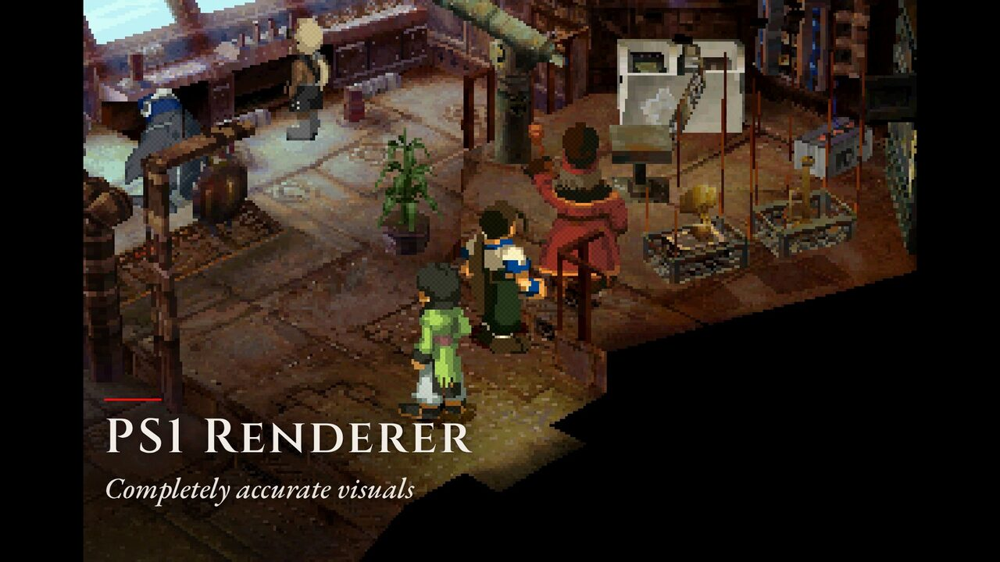

### See the world from a new perspective

In VR, play on a large virtual screen, or set the world down on the table in
front of you as a diorama: fields, battles and the world map become a living
miniature that you can grow or shrink with both hands, turn, tilt and recenter.
Where a headset browser offers mixed reality, the diorama sits in your own room.

  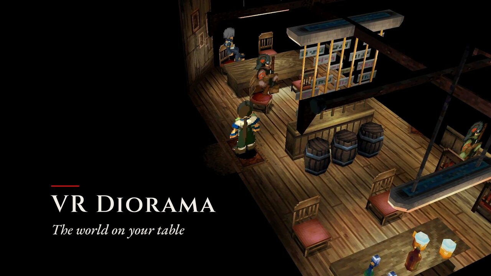
  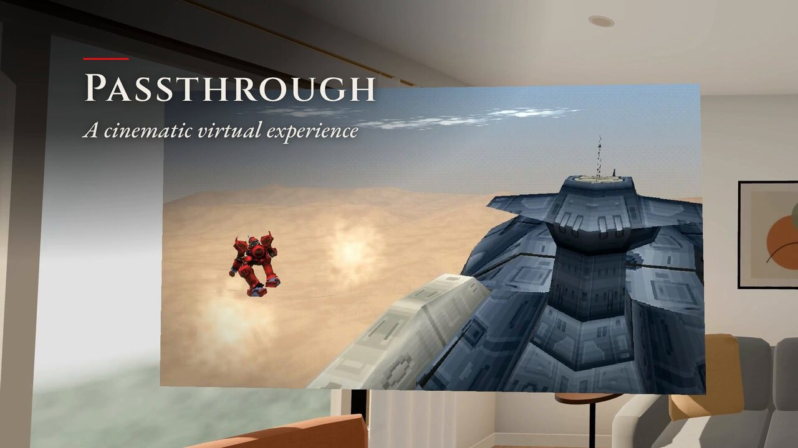

Stop anywhere in a field and look around through your character's eyes, on a
monitor, on a touch screen or in stereo VR, without turning Xenogears into a
first-person action game.

Optional hand-tracking controls (pinch to walk, a grab to pause, prayer hands
for Settings) work alongside full controller support, and touch screens and
headsets get control decks for Battling, the world map and every scripted field
activity. VR is an additional way to experience the game, not a requirement to
play.

  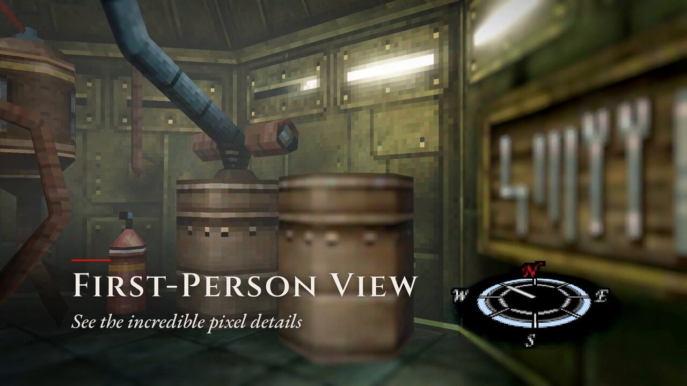
  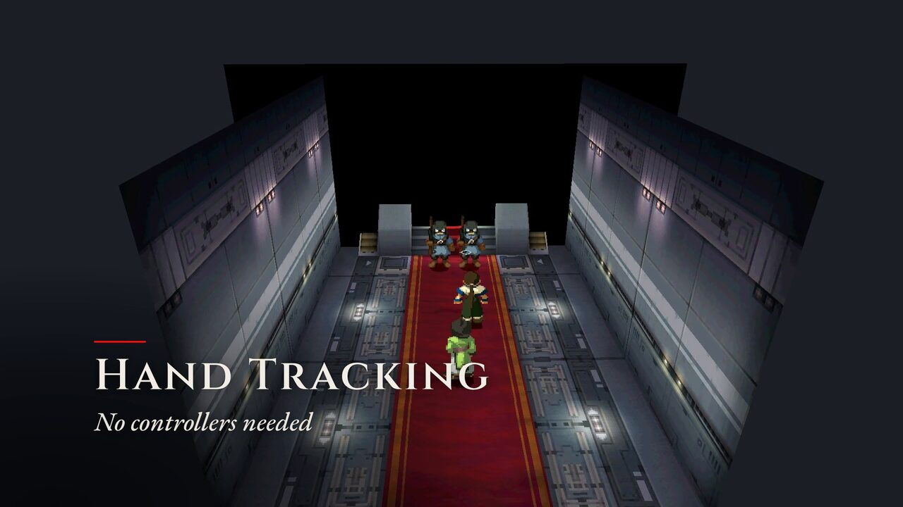

### Make a long adventure easier to live with

Save your exact moment anywhere and carry it between PC, browser, Android and
VR. Rewind the last few seconds when a jump or a choice goes wrong, and
fast-forward through travel and grinding while the music keeps its tempo. Bring
your old saves: XEM imports PlayStation memory cards and saves from DexDrive,
PSP and PS Vita, PS3, emulators and save tools, exports standard memory card
files, and needs no BIOS.

  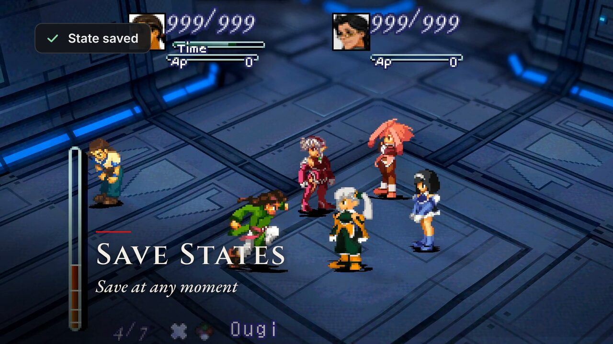
  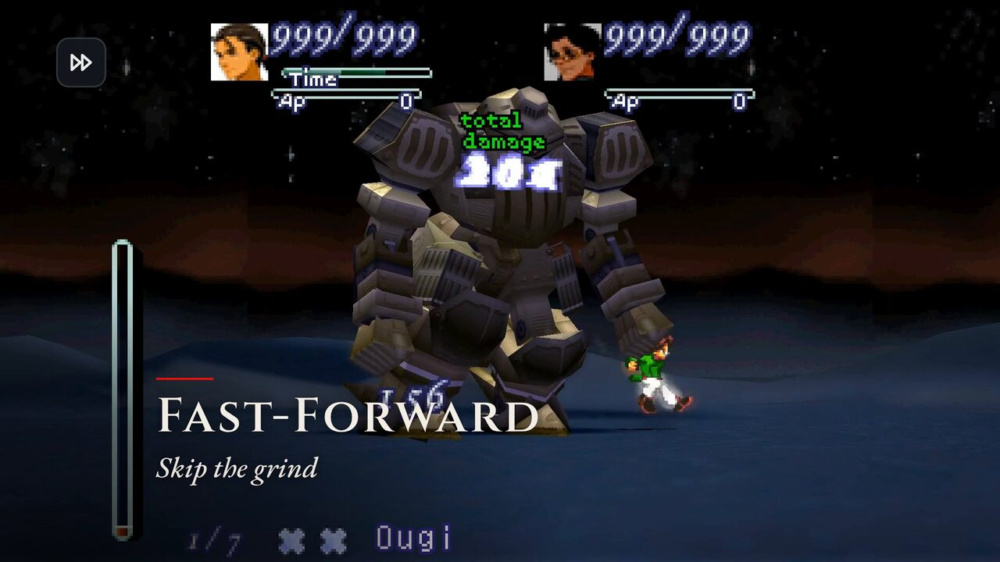

Gameplay options switch off random battles by default in the platforming areas
players complain about — Blackmoon Forest, the Aveh-Kislev border mountains and
Babel Tower — and can halve encounters in every field. Text can run faster, up
to instantly; dialogue can advance on its own; movies can be skipped; and disc
load times can be switched off, so areas and battles open almost at once.

### Hear the world around you

Binaural headphone mode places the soundtrack around you, arranged from the
game's own sequenced musical parts, and plays the world's sound effects from
where they happen, following your head in VR. It keeps the game's own choices
of what sounds, how loud and when. The original Mono, Stereo and Wide modes
remain exactly as they were.

### Create new Xenogears experiences

Mod support and desktop creation tools will open the way to custom levels,
cutscenes, battles and minigames. The plan includes mod management, gameplay
extensions and graphical editors built around the same game that players use.

AI-assisted authoring and automated playtesting are part of that vision, and its
foundation is in place. Software agents already play and inspect the real game
through a typed command interface that uses the same actions and settings as
players, with or without a visible game window, and recorded sessions replay
exactly on PC, in the browser, on Android and in VR. Human creators and agents
will work through the same editing, debugging and game services rather than a
separate approximation of Xenogears.

## Built around your own copy

XEM provides source code and tools, not the original game discs. Original disc
images, artwork, music and other extracted game assets are not distributed with
the project. Matching builds use data from the user's own supported discs, and
the native and browser versions import game data locally. Desktop first launch
organizes supported images into `discs/` beside the application; images are
never bundled or uploaded, and saves stay on your device.

The project's authored source is available under the [MIT License](LICENSE).
The English (Perfect Works) game text is the
[Perfect Works Build](https://github.com/PWBuild-Team/Perfect_Works_Build)
team's, a separate work under the GNU General Public License, version 3
([its files and notice](src/runtime/crates/xem-core/locale/en-x-pw/README.md)).

## Follow the project or get involved

Download the [latest release](https://github.com/brianblakely/xenogears-ex-machina/releases/latest)
or [play in your browser](https://brianblakely.github.io/xenogears-ex-machina/).
For desktop installation, place the executable beside your disc images in a
writable folder. First launch creates `discs/`, `cards/` and `saves/`.
See the [installation and qualification guide](docs/releases.md) for platform
requirements, upgrades and the emulator-based device matrix. Follow the
[roadmap](plan.md) for upcoming mod support and creation tools.

Developers can start with the [development guide](docs/development.md),
[runtime guide](docs/runtime.md), [porting handbook](docs/later-phases.md) and
[contribution guidelines](CONTRIBUTING.md).
