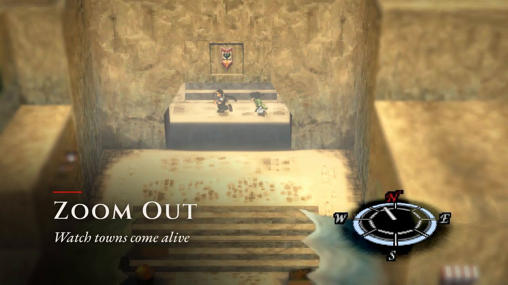
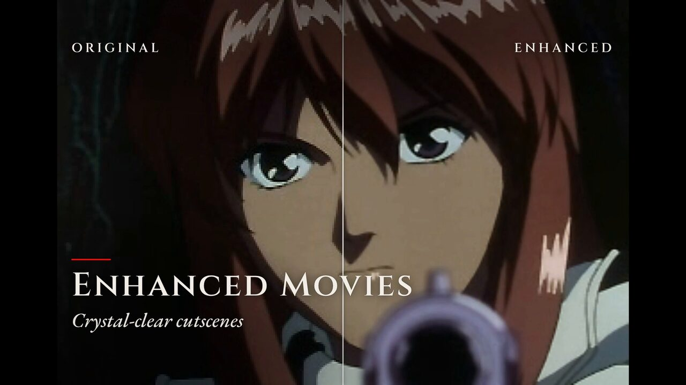
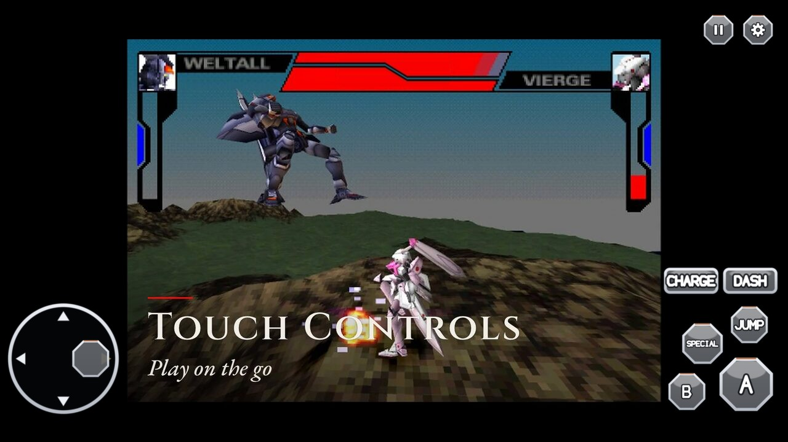
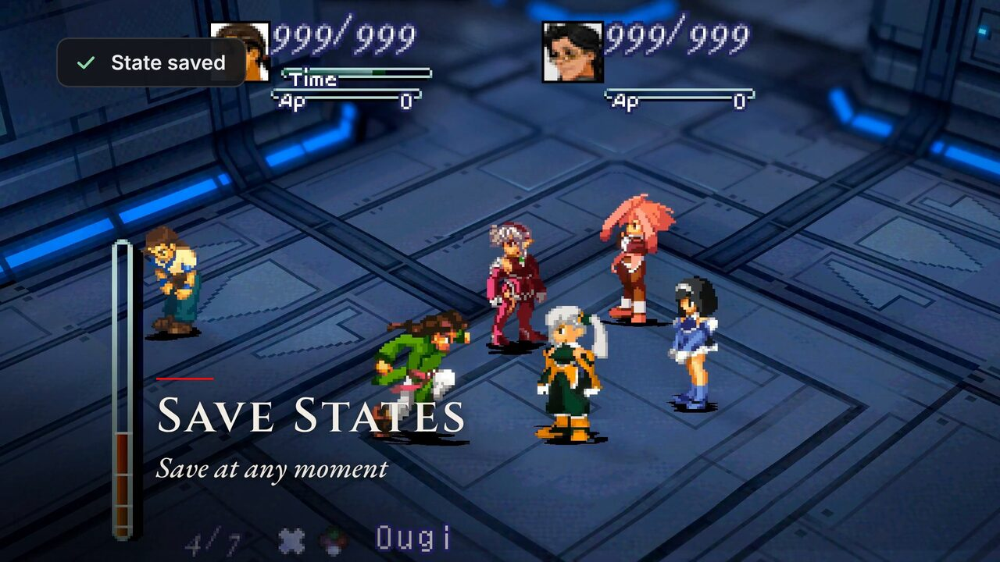

<h1 align="center">
  
</h1>

  <a href="https://github.com/brianblakely/xenogears-ex-machina/releases/latest"><b>Download</b></a>
  &nbsp;·&nbsp;
  <a href="MANUAL.md"><b>Player's manual</b></a>
  &nbsp;·&nbsp;
  <a href="docs/releases.md"><b>Installation guide</b></a>
   
  Windows · macOS · Linux · Steam Deck · Android · Meta Quest · PC VR · Bring your own discs

Xenogears: Ex Machina plays Xenogears, Square's 1998 PlayStation RPG, on your
computer, Steam Deck, Android phone or tablet, or VR headset. Put images of
your own discs beside it and play both discs, with the original art, music and
gameplay. There's no emulator to set up and no BIOS to track down.

Give Lahan modern lighting and shadows, or see it exactly as the console drew
it. On a wide screen, the village carries on past the old edges. Click a
villager and Fei walks over to talk. Stop by the well and look around through
his eyes. Put on headphones, pick Binaural, and the music plays all around
you. In VR, set the whole village on your table and walk round it.

## Features

### Graphics

- **HD-2D:** lighting, shadows, ambient occlusion, fog, light shafts, bloom,
  colour grading and depth of field, laid over the original sprites and
  textures.
- **Widescreen:** the extra space at the sides shows more of the scene, with
  nothing stretched.

  
  

- **Up to 8× resolution** at any window size, with shapes and textures that
  hold steady instead of wobbling.
- **Zoom out:** the mouse wheel pulls the field camera back up to five times
  farther.
- **High Framerate:** frames filled in between the game's own on
  high-refresh displays, with the game's timing unchanged.

  
  

- **Enhanced movies:** sharper, without the blocky compression edges.
- **PS1 look and Original renderer:** the low resolution, wobbling textures,
  jittering edges and dithering back again, or every frame drawn exactly as
  the console draws it. The Custom profile mixes old and new one effect at a
  time.

  
  

- **Full-size sprites** in Babel Tower, the hangars and the docks, where the
  game shrinks the party beside the Gears.

### First-person view and VR

- **First-person view** in any field: look around with the mouse, a stick, a
  finger or your head. The scenery was built for set camera angles, so some
  spots show a flat sprite or a missing wall.
- **VR diorama:** the world on your table, from a quarter to four times its
  size and tilted toward you. Walk round it and the people in it show their
  backs, sides and faces. Battles and the world map go on the table too.

  
  

- **Passthrough:** the diorama or a big virtual screen in your own room.
- **Hand tracking:** pinch the ground to walk there, close a fist to pause,
  press your palms together for Settings, pull your hands apart to enlarge
  the diorama.

  
  

On Windows and Linux, PC VR headsets start with one launch option. On Meta
Quest the app opens as a flat window for now, and starting it in VR takes an
extra step. The [manual](MANUAL.md#playing-in-a-headset) covers both.

### Controls

- **Mouse:** click the ground to walk there, click someone to go and talk to
  them, click battle commands and targets. Jumps are still yours to make.
- **Touch:** a stick wherever your left thumb lands, and buttons that change
  with what you're doing: TALK, NEXT and OK; WEAK, STRONG and FIERCE in
  battle; a set of their own for Battling.

  
  

- **Gamepads** work everywhere, Settings included, and every control can be
  rebound.

### Sound

- **Binaural audio** for headphones: the soundtrack's instrument parts around
  you and the world's sounds from where they happen. In a headset they stay
  put as you turn your head.
- The original **Mono, Stereo and Wide** modes, as they always sounded.

### Saves and quality of life

- **Save states** at any moment, and they move between every device.
- **Rewind** through the last 30 seconds.
- **Fast-forward** up to 20×, with the music at its own tempo and pitch.

  
  

- **No random battles in the jumping sections** of Blackmoon Forest, the
  Aveh–Kislev border mountains and Babel Tower (on from the start).
- **Half the random battles** everywhere else, each worth double EXP, G and
  Deathblow progress.
- **Skip disc load times:** areas, battles and menus open almost at once.
- **Instant text, auto dialogue and skippable movies.**
- **Hide the dialogue box** by holding Select.
- **Save imports** from DexDrive, PSP, PS Vita, PS3, emulators and Action
  Replay or GameShark tools, and standard memory card exports.

Story battles still happen and choices still wait for you. Any setting turned
off plays that part as the original did.

### Languages

- The original English script, the
  [Perfect Works Build](https://github.com/PWBuild-Team/Perfect_Works_Build)
  team's retranslation, French, Italian, Spanish and Brazilian Portuguese,
  switchable at any time with no patched discs.
- **Movie subtitles** in the language of the game text, timed by the
  Perfect Works Build team.
- On a computer, with your Japanese discs beside the North American ones:
  the Japanese release's text, or Japanese movies and battle voices with your
  own language.

A few words the game draws as pictures, like the battle commands and save
titles, stay in English, and so does the app's Settings screen.

### Achievements

- [RetroAchievements](https://retroachievements.org) on computers, Android
  and headsets, with badge popups. Unlocks are softcore, so save states,
  rewind and fast-forward stay available.

### Debug menu

- **Settings → Debug** opens the original game's test setups: jump to a map
  by number, set up a battle, play any movie or visit the developer room.
  Expect spoilers, and save first.

## Where it runs

- Windows (64-bit)
- macOS, on Apple Silicon and Intel
- Linux, on x86-64 and ARM, including Steam Deck (add it to Steam and play
  from Gaming Mode)
- Android 10 and later: phones, tablets and handhelds
- Meta Quest, and PC VR headsets on Windows and Linux

Save states and memory cards move between all of them. If you'd like to try it
without installing anything, there's also a
[browser version](https://brianblakely.github.io/xenogears-ex-machina/).

The project tests its Android and headset versions on emulators and simulated
headsets. If something misbehaves on your device, please
[let us know](https://github.com/brianblakely/xenogears-ex-machina/issues).

## Getting started

You need images of your own North American Xenogears discs: Disc 1
(`SLUS-00664`) and Disc 2 (`SLUS-00669`), original or Greatest Hits, as CHD or
BIN/CUE. The game itself isn't included.

- **On a computer:** download the app, put your disc images beside it and open
  it. It files them into a `discs` folder and starts Disc 1.
- **On Android or Quest:** install the APK and pick your disc image when the
  app asks.

Your discs and saves stay on your device. The [player's manual](MANUAL.md)
covers controls, settings and saves, and the
[installation guide](docs/releases.md) covers Steam Deck setup, Linux
permissions, macOS, updates and current limitations.

The whole game runs, both discs. A start-to-finish check of the story and
every side activity is still under way, so if something looks wrong, please
[report it](https://github.com/brianblakely/xenogears-ex-machina/issues).

## What's next

Mod support and creation tools come next: mod management, gameplay extensions
and desktop editors for new areas, scenes, battles and minigames, all built on
the same game you play. The [roadmap](plan.md) has the details.

## Credits and license

Xenogears: Ex Machina is an independent fan project, not affiliated with or
endorsed by Square Enix. It includes none of the game's data: no disc images,
artwork, music or BIOS.

The project's source code is available under the [MIT License](LICENSE).
The English (Perfect Works) game text and the movie subtitles are the
[Perfect Works Build](https://github.com/PWBuild-Team/Perfect_Works_Build)
team's (version 0.11.4), separate works under the GNU General Public License,
version 3 ([the text's files and notice](src/runtime/crates/xem-core/locale/en-x-pw/README.md),
[the subtitles'](src/runtime/crates/xem-core/subtitles/README.md)).

## For developers

Under the hood, Ex Machina is a matching decompilation: reconstructed C source
for all 26 program components on both discs, which rebuilds byte for byte into
the original executables. That source is compiled once into a game module,
which runs natively on desktop, Android and headsets and as WebAssembly in
browsers, with a Rust host handling graphics, sound, input and saves.

Start with the [development guide](docs/development.md),
[runtime guide](docs/runtime.md), [build and verification guide](docs/matching.md),
[porting handbook](docs/later-phases.md), [roadmap](plan.md) and
[contribution guidelines](CONTRIBUTING.md).
