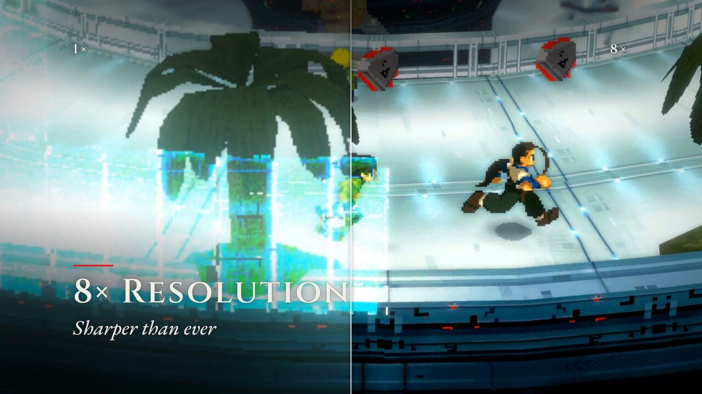
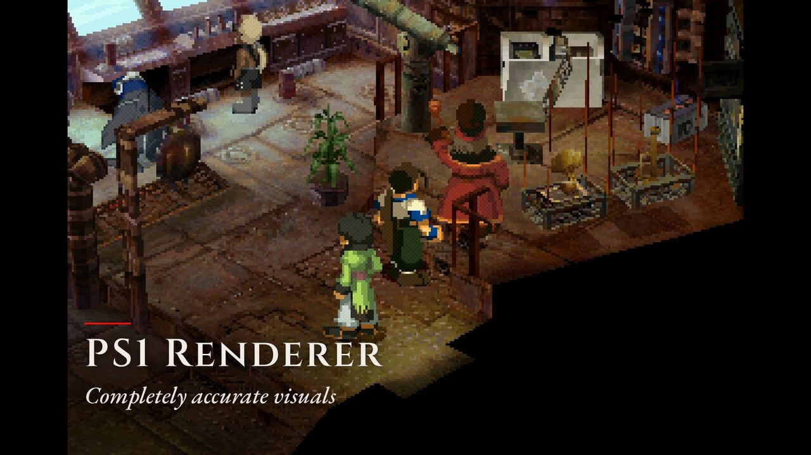
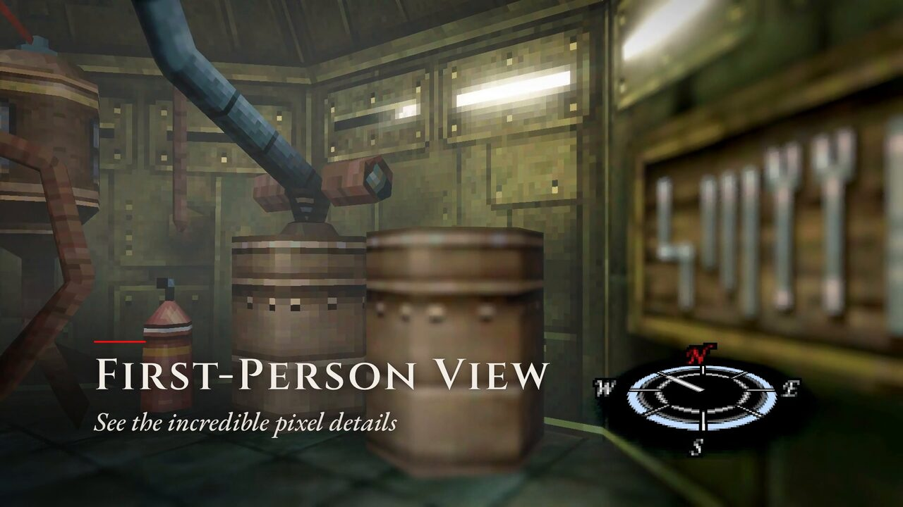
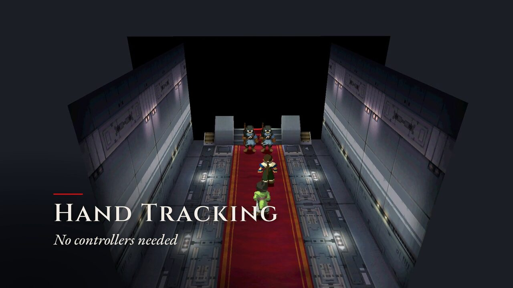
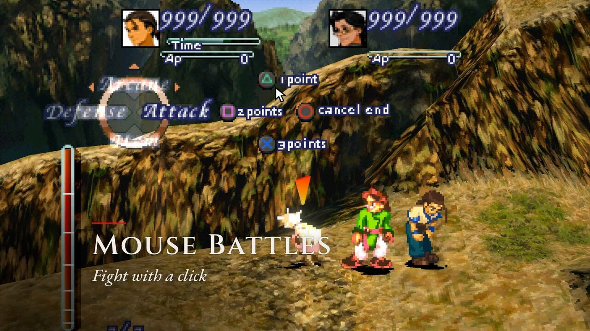

<h1 align="center">
  
</h1>

  <a href="https://github.com/brianblakely/xenogears-ex-machina/releases/latest"><b>Download</b></a>
  &nbsp;·&nbsp;
  <a href="MANUAL.md"><b>Player's manual</b></a>
  &nbsp;·&nbsp;
  <a href="docs/releases.md"><b>Installation guide</b></a>
   
  Windows · macOS · Linux · Steam Deck · Android · Meta Quest · PC VR · Bring your own discs

Xenogears: Ex Machina plays Xenogears, Square's 1998 PlayStation RPG, on your
computer, Steam Deck, Android phone or tablet, or VR headset. Put images of
your own discs beside it and play both discs, with the original art, music and
gameplay. There's no emulator to set up and no BIOS to track down.

Give Lahan modern lighting and shadows, or see it exactly as the console drew
it. On a wide screen, the village carries on past the old edges. Click a
villager and Fei walks over to talk. Stop by the well and look around through
his eyes. Put on headphones, pick Binaural, and the music plays all around
you. In VR, set the whole village on your table and walk round it.

## Lighting, widescreen and a sharper picture

Switch on HD-2D and Lahan gets lighting, shadows, fog, light shafts, bloom and
depth of field, laid over the same sprites and textures Square shipped in
1998. On a wide screen nothing is stretched: the extra space at the sides
shows more of Shevat's tower.

  
  

Scenes are drawn at up to eight times the PlayStation's resolution, at any
window size, with shapes and textures that hold steady instead of wobbling.
Roll the mouse wheel and the camera pulls back, up to five times farther. On a
high-refresh display, High Framerate fills in frames between the game's own
while the game keeps its timing.

  
  

Movies come out sharper, without their blocky compression edges. When you want
it the way it was, the PS1 look brings back the low resolution, wobbling
textures, jittering edges and dithering (the Custom profile mixes them with
the new effects one at a time), and the Original renderer draws every frame
exactly as the console does.

  
  

In Babel Tower, the hangars and the docks, where the game shrinks the party to
tiny sprites beside the Gears, you can have the party drawn with its detailed
sprites instead.

## Look around, or set the world on your table

Switch to first person in Citan's workshop and look around: up at the pipes,
across at the wrenches on his wall. Look with the mouse, a stick or a finger,
or in a headset just turn your head. It works in any field. The scenery was
built for set camera angles, so from some spots you'll catch a flat sprite or
a missing wall.

In a headset, set the world on the table in front of you. Lean over the
tavern, grow it to four times its size or shrink it to a quarter, tilt it
toward you, or get up and walk round the table: the people in it turn to show
you their backs, their sides and their faces. Battles and the world map go on
the table too.

  
  

With passthrough, the diorama or a big virtual screen appears in your own
room. Put the controllers down if you like: pinch the ground to walk there,
close a fist to pause, press your palms together for Settings, and pull your
hands apart to enlarge the diorama.

  
  

On Windows and Linux, PC VR headsets start with one launch option. On Meta
Quest the app opens as a flat window for now, and starting it in VR takes an
extra step. The [manual](MANUAL.md#playing-in-a-headset) covers both.

## Click to walk, tap to talk

Click the ground and Fei walks there, or click someone and he goes over and
talks to them. In battle, click a command on the ring, then your target. The
jumps are still yours to make.

On a phone or tablet, put your thumb down anywhere on the left half of the
screen and a stick appears under it. The big button under your right thumb is
TALK while you explore, NEXT in a conversation and OK in a menu. When you
attack in battle, the buttons read WEAK, STRONG and FIERCE, and a Battling
bout gets its own set.

  
  

Any gamepad works everywhere, Settings included, and you can rebind every
control.

## Sound all around you

Choose Binaural with headphones on, and the soundtrack's instrument parts
spread out around you while the world's sounds come from where they happen in
the scene. In a headset they stay put as you turn your head, and the music can
too. The game still decides what plays, when and how loud, and its Mono,
Stereo and Wide modes sound as they always did.

## Save anywhere, rewind, skip the grind

Save in the middle of a boss fight and finish it later on your phone. Missed a
jump in Babel Tower? Hold rewind and back up through the last 30 seconds.
Cross the world map at 20 times speed while the music keeps its tempo and
pitch.

  
  

Settings smooth over the parts that have aged:

- No random battles in the jumping sections of Blackmoon Forest, the
  Aveh–Kislev border mountains and Babel Tower. This one is on from the start.
- Half as many random battles in every field, each worth double EXP, G and
  Deathblow progress.
- No waiting for the disc: areas, battles and menus open almost at once.
- Instant text, dialogue that turns its own pages, and movies you can skip.

Story battles still happen, choices still wait for you, and a setting turned
off plays that part as the original did. Hold Select to hide a dialogue box
and see the scene behind it. Bring your old saves from DexDrive, PSP, PS Vita,
PS3, emulators and Action Replay or GameShark tools, and take standard memory
card files back out.

## In your language

Switch between the original English script, the
[Perfect Works Build](https://github.com/PWBuild-Team/Perfect_Works_Build)
team's retranslation and the game's text in French, Italian, Spanish or
Brazilian Portuguese whenever you like, with no patched discs. On a computer,
put your Japanese discs beside the North American ones to play with the
Japanese release's text, or keep your language and switch the movies and
battle voices to Japanese.

A few words the game draws as pictures, like the battle commands and save
titles, stay in English, and so does the app's Settings screen.

## Achievements

Sign in to [RetroAchievements](https://retroachievements.org) on a computer,
Android device or headset, and each achievement you earn pops up over the game
with its badge. Unlocks count as softcore, so save states, rewind and
fast-forward stay available.

## The developers' test rooms

**Settings → Debug** opens the test setups built into the original game: jump
to a map by number, set up a battle, play any movie or visit the developer
room. Expect spoilers, and save first.

## Where it runs

- Windows (64-bit)
- macOS, on Apple Silicon and Intel
- Linux, on x86-64 and ARM, including Steam Deck (add it to Steam and play
  from Gaming Mode)
- Android 10 and later: phones, tablets and handhelds
- Meta Quest, and PC VR headsets on Windows and Linux

Save states and memory cards move between all of them. If you'd like to try it
without installing anything, there's also a
[browser version](https://brianblakely.github.io/xenogears-ex-machina/).

The project tests its Android and headset versions on emulators and simulated
headsets. If something misbehaves on your device, please
[let us know](https://github.com/brianblakely/xenogears-ex-machina/issues).

## Getting started

You need images of your own North American Xenogears discs: Disc 1
(`SLUS-00664`) and Disc 2 (`SLUS-00669`), original or Greatest Hits, as CHD or
BIN/CUE. The game itself isn't included.

- **On a computer:** download the app, put your disc images beside it and open
  it. It files them into a `discs` folder and starts Disc 1.
- **On Android or Quest:** install the APK and pick your disc image when the
  app asks.

Your discs and saves stay on your device. The [player's manual](MANUAL.md)
covers controls, settings and saves, and the
[installation guide](docs/releases.md) covers Steam Deck setup, Linux
permissions, macOS, updates and current limitations.

The whole game runs, both discs. A start-to-finish check of the story and
every side activity is still under way, so if something looks wrong, please
[report it](https://github.com/brianblakely/xenogears-ex-machina/issues).

## What's next

Mod support and creation tools come next: mod management, gameplay extensions
and desktop editors for new areas, scenes, battles and minigames, all built on
the same game you play. The [roadmap](plan.md) has the details.

## Credits and license

Xenogears: Ex Machina is an independent fan project, not affiliated with or
endorsed by Square Enix. It includes none of the game's data: no disc images,
artwork, music or BIOS.

The project's source code is available under the [MIT License](LICENSE).
The English (Perfect Works) game text is the
[Perfect Works Build](https://github.com/PWBuild-Team/Perfect_Works_Build)
team's (version 0.11.4), a separate work under the GNU General Public License,
version 3 ([its files and notice](src/runtime/crates/xem-core/locale/en-x-pw/README.md)).

## For developers

Under the hood, Ex Machina is a matching decompilation: reconstructed C source
for all 26 program components on both discs, which rebuilds byte for byte into
the original executables. That source is compiled once into a game module,
which runs natively on desktop, Android and headsets and as WebAssembly in
browsers, with a Rust host handling graphics, sound, input and saves.

Start with the [development guide](docs/development.md),
[runtime guide](docs/runtime.md), [build and verification guide](docs/matching.md),
[porting handbook](docs/later-phases.md), [roadmap](plan.md) and
[contribution guidelines](CONTRIBUTING.md).
