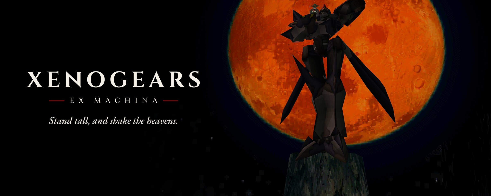
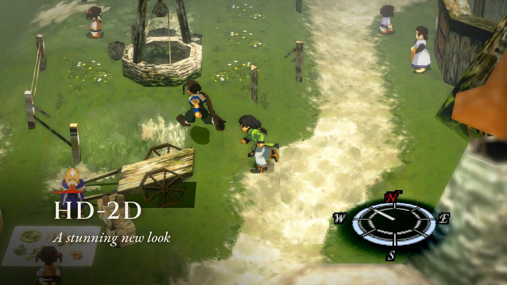
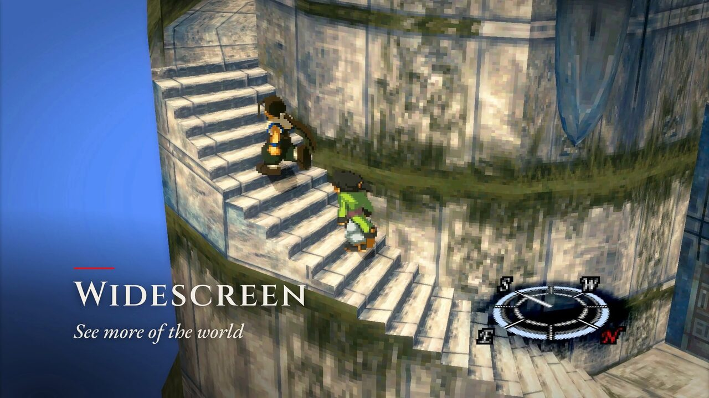
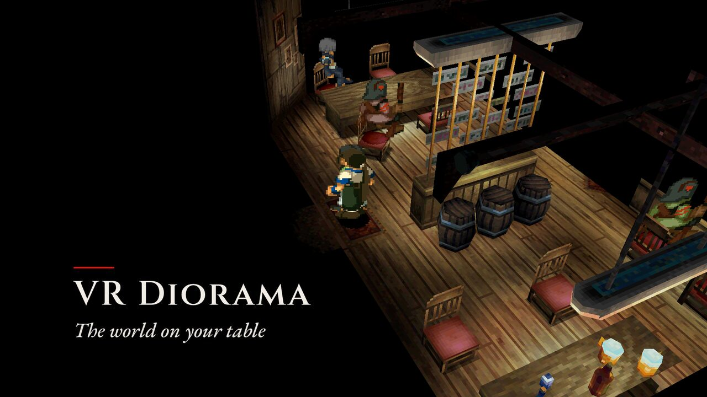
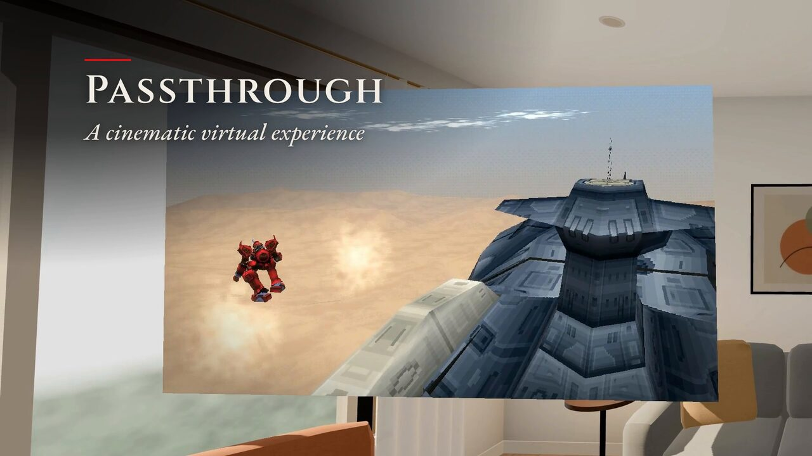
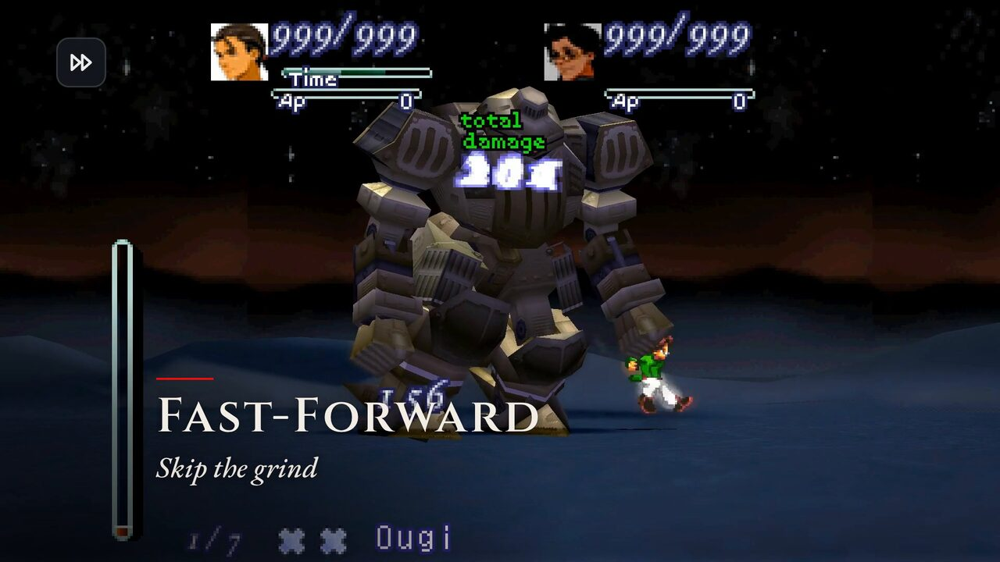

<h1 align="center">
  
</h1>

  <a href="https://github.com/brianblakely/xenogears-ex-machina/releases/latest"><b>Download</b></a>
  &nbsp;·&nbsp;
  <a href="MANUAL.md"><b>Player's manual</b></a>
  &nbsp;·&nbsp;
  <a href="docs/releases.md"><b>Installation guide</b></a>
   
  Windows · macOS · Linux · Steam Deck · Android · Meta Quest · PC VR · Bring your own discs

Xenogears: Ex Machina is an app for playing Xenogears, Square's 1998
PlayStation RPG, on your computer, Steam Deck, Android phone or tablet, or VR
headset. Put images of your own discs beside it and play. There's no emulator
to set up and no BIOS to track down.

The whole game is here, both discs, with its original art, music and
gameplay. Around it, the app adds what you'd expect from a modern release: a
sharper picture, true widescreen, saving anywhere, rewind, fast-forward, mouse
and touch controls, more languages, and no random battles in the worst
jumping sections. It also does things that only work because it understands
the game it's running, like lighting scenes, letting you look around in first
person, setting the world on your table in VR and placing sound around your
head.

## How it's different

There are two usual ways to play an old console game on new hardware. An
emulator imitates the PlayStation and runs your disc on that imitation. A
remake or engine port rebuilds the game by hand in a new engine and works to
match the original.

Ex Machina takes a different route. The project worked backward from the
discs to recover the game's own program as readable source code, and checked
every part of it until it rebuilt into exactly the bytes on the original
discs. That recovered program is compiled to run directly on your device, not
inside an imitation PlayStation.

So the game you play is the original. Battle formulas, enemy behavior, event
scripts, minigames and the odd bug all come from Square's own code, on both
discs. Nothing was redrawn or rewritten by hand, so it plays the way you
remember.

The app also knows what the game is doing. An emulator works with the
triangles and audio a PlayStation would put out, without knowing what they
mean. Ex Machina knows where Fei is standing, what the camera is looking at,
which musical part is playing and where each sound comes from. That's how it
can light a scene, fill the sides of a widescreen picture with real scenery,
show the world through a character's eyes, put a town on your table in VR,
place sounds around your head and walk Fei to the spot you clicked.

None of this replaces the original. The console's own picture and sound modes
are still there, and every gameplay change can be switched off.

## A sharper picture, or the original one

Ex Machina redraws the game's 3D scenes at up to eight times the PlayStation's
resolution, at any window size. Widescreen doesn't stretch anything: the extra
room at the sides shows more of the game's own scenery. On high-refresh
displays, optional motion smoothing fills in frames between the game's own
while the game keeps its original timing.

Pick a look:

- **Modern:** a clean, sharp picture with steady textures.
- **HD-2D:** scene lighting, shadows, fog, light shafts, bloom and depth of
  field over the original sprites and models.
- **PS1:** the console's low resolution with its wobbling textures, jittering
  edges, dithering and limited colours. The Custom profile lets you mix those
  quirks with the modern effects one at a time.
- **Original:** the picture exactly as the console draws it.

Every look uses the art Square made in 1998. There's no texture pack to
download and nothing has been repainted. In Gear-sized places like Babel
Tower and the hangars, where the game swaps the party for tiny low-detail
sprites, you can have it draw their detailed ones instead.

  
  
  
  

The field camera can pull back up to five times farther, so you can take in a
whole town at once. Movies get cleaned up too: Ex Machina smooths out the
blocky compression and sharpens the enlarged picture, with the original video
a toggle away.

  
  

## Play with whatever you have

A keyboard, a mouse, any gamepad, a touch screen, VR controllers or your bare
hands all work, and you can rebind every control.

- **Mouse:** click the ground to walk there, click a person to go and talk to
  them, and click battle commands and targets. The scroll wheel zooms the
  camera. The jumps are still yours to make.
- **Controller:** gamepads work everywhere, Settings included, so you never
  have to reach for the keyboard. Save states, rewind and fast-forward have
  their own button combinations.
- **Touch:** made for two thumbs. Put your left thumb down anywhere and a
  stick appears under it. The buttons under your right thumb change with what
  you're doing: TALK and JUMP while exploring, NEXT in conversations, the
  three attacks by name in battle, and a full set for Battling. You can also
  tap where you want to go.

  
  

## Step into the world

In a VR headset, play on a large virtual screen, or set the world down on the
table in front of you as a diorama. Fields, battles and the world map become a
miniature you can grow, shrink, turn and tilt. On headsets that can show your
room, the diorama sits on your real table.

  
  

On any screen, you can stop in a field and look around through your
character's eyes, with the mouse, a stick, a finger or, in VR, your own head.
Your character stays put while you look. The scenery was built for set camera
angles, so from some spots you'll catch a flat sprite or a missing wall.

Controllers work fully in VR, and hand tracking is there if you want it: pinch
to walk, make a fist to pause, press your palms together for Settings, and
pull both hands apart to enlarge the diorama.

  
  

On Windows and Linux, PC VR headsets start with one launch option. On Meta
Quest the app currently opens as a flat window, and starting it in VR takes an
extra step. The [manual](MANUAL.md#playing-in-a-headset) covers both.

## Sound all around you

Put on headphones and switch to Binaural. The soundtrack is laid out around
you from the game's own instrument parts, and sound effects come from where
they happen in the scene. In VR, effects stay in place as you turn your head,
and the music can too. The game still decides what plays, when and how loud,
and the original Mono, Stereo and Wide modes are untouched.

## A long RPG that fits around your life

Xenogears is a long game, and a few parts of it have aged. All of these are
optional:

- **Save anywhere.** A save state keeps the exact moment, mid-battle and
  mid-conversation included. Take it to your phone or another computer and
  carry on.
- **Rewind.** Missed a jump? Back up through the last half minute and try
  again.
- **Fast-forward.** Speed through travel and grinding at up to 20 times, or
  as fast as your machine can go. The music keeps its normal tempo and pitch.
- **Fewer random battles.** They're off by default in the jumping sections of
  Blackmoon Forest, the Aveh–Kislev border mountains and Babel Tower. You can
  also halve encounters everywhere, and each battle then gives double EXP, G
  and Deathblow progress, so you don't fall behind.
- **No disc loading.** Areas, battles and menus open almost at once.
- **Text at your pace.** Fast or instant text, dialogue that advances on its
  own, and movies you can skip. Hold Select to hide a dialogue box and see the
  scene behind it.
- **Your old saves.** Import memory cards and saves from DexDrive, PSP, PS
  Vita, PS3, emulators and Action Replay or GameShark tools, and export
  standard memory card files.

Story battles still happen and choices still wait for you. Turn an option off
and the game plays exactly as it always did.

  
  

## In your language

Play with the original English script, the
[Perfect Works Build](https://github.com/PWBuild-Team/Perfect_Works_Build)
team's English retranslation, or the game's text in French, Italian, Spanish
or Brazilian Portuguese. They're all built in, so there are no patched discs
to make, and you can switch at any time.

Put your Japanese discs beside the North American ones on a computer and you
can also play with the Japanese release's text, or keep your language and
switch the movies and battle voices to Japanese.

A few words the game draws as pictures, like the battle commands and save
titles, stay in English, and so does the app's Settings screen.

## Achievements

Sign in to [RetroAchievements](https://retroachievements.org) on a computer,
Android device or headset and earn Xenogears' achievements as you play. Each
unlock pops up over the game with its badge. Unlocks count as softcore, so
save states, rewind and fast-forward stay available.

## The developers' test rooms

**Settings → Debug** opens the test setups built into the original game: jump
to a map by number, set up a battle, play any movie or visit the developer
room. Expect spoilers, and save first.

## Where it runs

- Windows (64-bit)
- macOS, on Apple Silicon and Intel
- Linux, on x86-64 and ARM, including Steam Deck (add it to Steam and play
  from Gaming Mode)
- Android 10 and later: phones, tablets and handhelds
- Meta Quest, and PC VR headsets on Windows and Linux

Save states and memory cards move between all of them. If you'd like to try it
without installing anything, there's also a
[browser version](https://brianblakely.github.io/xenogears-ex-machina/).

The project tests its Android and headset versions on emulators and simulated
headsets. If something misbehaves on your device, please
[let us know](https://github.com/brianblakely/xenogears-ex-machina/issues).

## Getting started

You need images of your own North American Xenogears discs: Disc 1
(`SLUS-00664`) and Disc 2 (`SLUS-00669`), original or Greatest Hits, as CHD or
BIN/CUE. The game itself isn't included.

- **On a computer:** download the app, put your disc images beside it and open
  it. It files them into a `discs` folder and starts Disc 1.
- **On Android or Quest:** install the APK and pick your disc image when the
  app asks.

Your discs and saves stay on your device. The [player's manual](MANUAL.md)
covers controls, settings and saves, and the
[installation guide](docs/releases.md) covers Steam Deck setup, Linux
permissions, macOS, updates and current limitations.

The whole game runs, both discs. A start-to-finish check of the story and
every side activity is still under way, so if something looks wrong, please
[report it](https://github.com/brianblakely/xenogears-ex-machina/issues).

## What's next

Mod support and creation tools come next: mod management, gameplay extensions
and desktop editors for new areas, scenes, battles and minigames, all built on
the same game you play. The [roadmap](plan.md) has the details.

## Credits and license

Xenogears: Ex Machina is an independent fan project, not affiliated with or
endorsed by Square Enix. It includes none of the game's data: no disc images,
artwork, music or BIOS.

The project's source code is available under the [MIT License](LICENSE).
The English (Perfect Works) game text is the
[Perfect Works Build](https://github.com/PWBuild-Team/Perfect_Works_Build)
team's (version 0.11.4), a separate work under the GNU General Public License,
version 3 ([its files and notice](src/runtime/crates/xem-core/locale/en-x-pw/README.md)).

## For developers

Under the hood, Ex Machina is a matching decompilation: reconstructed C source
for all 26 program components on both discs, which rebuilds byte for byte into
the original executables. That source is compiled once into a game module,
which runs natively on desktop, Android and headsets and as WebAssembly in
browsers, with a Rust host handling graphics, sound, input and saves.

Start with the [development guide](docs/development.md),
[runtime guide](docs/runtime.md), [build and verification guide](docs/matching.md),
[porting handbook](docs/later-phases.md), [roadmap](plan.md) and
[contribution guidelines](CONTRIBUTING.md).
